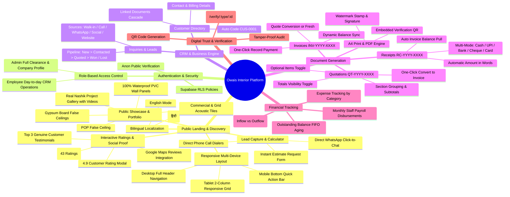
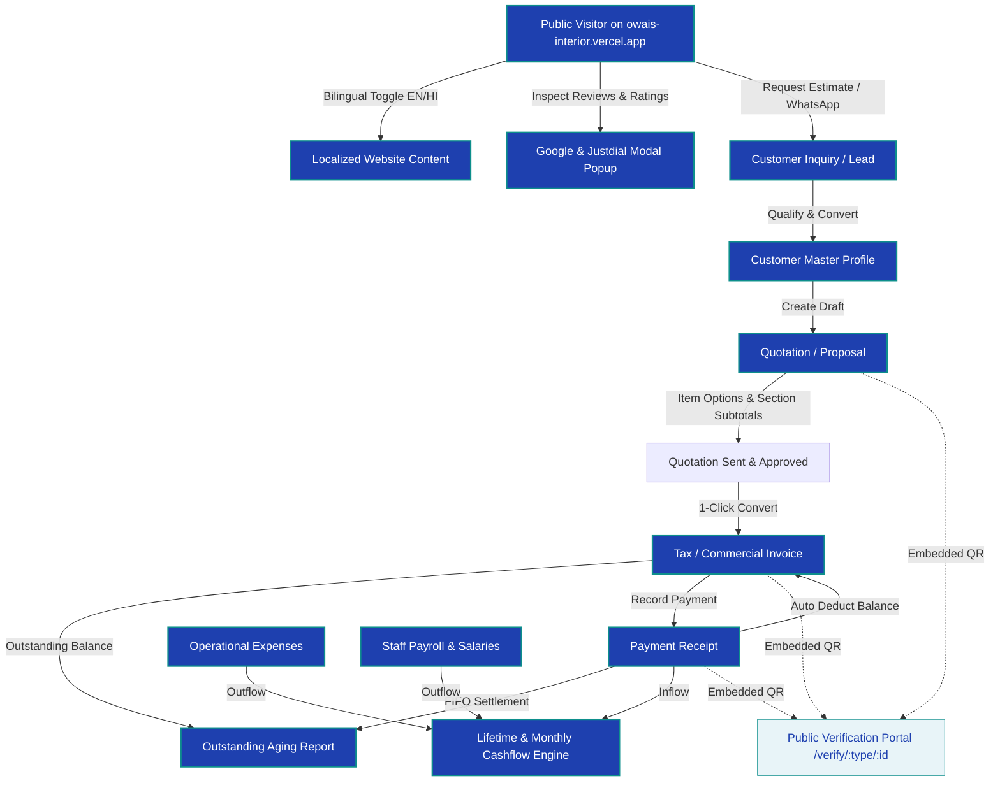
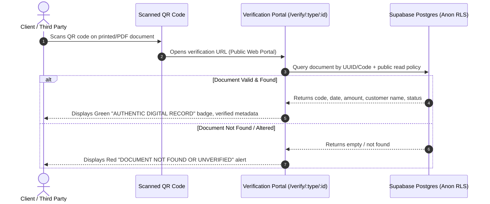

# Owais Interior Designer CRM & Public Platform

A comprehensive, enterprise-grade web-based CRM, ERP, and Public Marketing Platform built for **Owais Interior Designer**. It unifies the entire business lifecycle — from lead capture, public discovery, and bilingual engagement to advanced quotation building with section grouping, dynamic invoicing, receipt generation, outstanding debt recovery, staff payroll, company expense tracking, real-time cashflow analytics, interactive customer review modals, and public QR-code-based document authenticity verification.

---

## Brand & Business Profile

| Property | Details |
|---|---|
| **Company Name** | Owais Interior Designer |
| **Tagline** | *"Turning your space into elegant design"* / *"Nashik POP & PVC Specialists"* |
| **Operating Location** | Rahmat Nagar, Wadala, Nashik, Maharashtra 422006, India |
| **Direct Contact** | +91 7756043214 / +91 7721926290 · `onlyw6469@gmail.com` |
| **Public Live URL** | [owais-interior.vercel.app](https://owais-interior.vercel.app) |
| **Currency** | Indian Rupee (INR - ₹) · Non-GST / Composition Billing Standard |
| **Brand Colors** | Royal Blue (`#1D4ED8` / `#1E40AF`), Accent Teal (`#0E8F8C`), Crisp White (`#FFFFFF`), Soft Cream (`#F7FAFD`) |

---

## High-Level Architecture Mindmap



---

## End-to-End Business Flow



---

## Comprehensive Module Breakdown

### 1. Public Landing & Discovery Website (`/`)
* **Responsive Multi-Device Layout (Desktop, Tablet, Mobile)**:
  * Zero horizontal page wobble (`overflow-x: hidden`, `max-width: 100vw`, `box-sizing: border-box`).
  * Dedicated Mobile Bottom Quick-Action Bar (`WhatsApp`, `Call Now`, `Instant Quote`) fixed on screen.
  * Adaptive mobile navigation drawer with hamburger toggle.
* **Bilingual Localization (English & हिंदी Toggle)**:
  * Two-button language selector in the announcement bar and mobile drawer.
  * Real-time language translation across headers, hero copy, trust metrics, service descriptions, quote forms, and FAQs.
* **Interactive Customer Rating & Reviews Modal**:
  * Clickable **"4.9 ★ Customer Rating"** badge opens a glassmorphic dark-navy modal.
  * Side-by-side platform summary cards:
    * **Google Reviews**: 4.9 ★ (Owais Interior Designer, Nashik) with direct link to Google Maps.
    * **Justdial Verified Profile**: 4.7 ★ (43 Ratings) with direct link to Justdial.
  * Top 3 genuine customer testimonials displayed directly inside the modal with star ratings.
* **Service Showcase & Rate Display**:
  * POP False Ceilings, 100% Waterproof PVC Wall Panels, Gypsum Board False Ceilings, and Commercial Grid Ceilings.
  * Dynamic pricing pulled from company profile or admin customization.
* **Real Project Showcase**:
  * Uncropped photo portfolio cards showing actual completed jobs across Nashik (Gangapur Road, Indira Nagar, College Road, Govind Nagar) with direct WhatsApp inquiry triggers.

### 2. Authentication & Role-Based Access Control (RBAC)
* **Dedicated Gateways**: Dedicated role selection between Administrator (`/admin-login`) and Staff/Employee (`/employee-login`) portals.
* **Role Enforcement**:
  * **Admin**: Complete system clearance including company profile, company assets (logo, authorized stamp, signature), user passwords, and settings.
  * **Employee**: Operational clearance for inquiries, customers, quotes, invoices, receipts, and payroll; restricted from company identity and credentials settings.
* **Supabase Auth & Session Handling**: Secure token-based session persistence, password reset flow, and local storage state persistence.

### 3. Inquiry & Pipeline Lead Management
* **Channel Source Tagging**: Logs inquiries originating from Walk-in, Phone Calls, WhatsApp, Instagram, Website, or Referrals.
* **Lifecycle Pipeline**: Visual progression: `New` &rarr; `Contacted` &rarr; `Quoted` &rarr; `Won` / `Lost`.
* **Instant Customer Conversion**: Converts qualified inquiries to complete Customer records with pre-populated phone numbers, service details, and requirements.

### 4. Customer Master Directory
* **Deterministic Auto-Coding**: Sequenced identifier generation (`CUS-0001`, `CUS-0002`).
* **Complete Metadata**: Full customer name, validated 10-digit mobile number, alternate contact, billing address, site location, city, and notes.
* **Comprehensive Search**: Multi-vector real-time filtering across customer name, phone number, customer code, and city.

### 5. Advanced Quotation & Proposal Builder
* **Custom Sequence**: Auto-generated sequential identifiers (`QT-2026-0001`).
* **Section Grouping & Subtotals**: Categorize line items into named zones/rooms (e.g., *Living Room*, *Master Bedroom*, *Modular Kitchen*, *False Ceiling*).
* **Section Subtotal Visibility**: Toggle `show_section_subtotals` on/off based on customer presentation needs.
* **Optional Line Items**: Mark individual rows as optional proposals (`include_in_total = false`). Renders with an `OPTION` badge, excluding cost from final calculation.
* **Optional Totals Display**: Toggle `show_totals` to produce clean itemized scope-of-work sheets without showing monetary sums.
* **One-Click Invoice Conversion**: Instantly creates a complete linked invoice carrying over all line items, rates, and customer relationships.

### 6. Invoicing & Billing Engine
* **Invoice Sequences**: Standardized sequential codes (`INV-2026-0001`).
* **Real-time Balance Computation**: Syncs total invoiced against linked receipt payments.
* **Dynamic Status Synchronization**: Transitions automatically between `Unpaid`, `Partially Paid`, `Paid`, and `Cancelled`.
* **Quick Payment Settlement**: One-click "Record Payment" button launches a pre-filled receipt builder directly tied to the target invoice.

### 7. Payment Receipts
* **Sequenced Receipt Numbers**: (`RC-2026-0001`).
* **Smart Balance Fetching**: Automatically loads prior payments, calculates outstanding balance, and computes remaining dues.
* **Multi-Mode Support**: Cash, UPI, Direct Bank Transfer, Cheque, Credit/Debit Cards.
* **Indian Currency Number-to-Words**: Automatically converts numbers into words (e.g., *"Rupees One Lakh Twenty-Five Thousand Only"*).

### 8. Outstanding Debt Recovery & FIFO Settlement
* **Customer-Level Rollups**: Aggregates total invoiced, total collected, net pending receivables, and pending invoice count.
* **Expandable Details**: Inspect individual invoice line items and payment histories per client.
* **FIFO Settlement Engine**: Receipts settle oldest pending invoices first, preventing billing discrepancies.
* **Visual Overdue Alerting**: Flags unpaid invoices exceeding due dates in bold crimson badges.

### 9. Staff Directory & Monthly Payroll
* **Staff Master**: Manage design assistants, site supervisors, carpenters, and contractors with monthly salary contracts, designations, phone numbers, and active/inactive status.
* **Salary Payout Logging**: Record payout disbursements with date, period (`YYYY-MM`), mode, reference notes, and receipts.
* **Live Commitment Overview**: Real-time KPI cards calculating total active personnel and total monthly salary commitments.

### 10. Company Expenses & Cashflow Engine
* **Expense Categories**: Outflow classification across *Material*, *Transport*, *Food/Chai*, *Office Supplies*, *Marketing*, and *Other*.
* **Real-time Financial KPI Matrix**:
  * **Lifetime Inflow**: Real-time sum of all verified customer receipt collections.
  * **Lifetime Outflow**: Aggregated sum of operational expenses and employee salary payouts.
  * **Lifetime Net Cash**: Available company cash reserves (`Inflow - Outflow`).
  * **This Month Outflow**: Current month's burn rate across operational expenses and salaries.

### 11. Public Document Authenticity & QR Verification
* **Tamper-Proof Verification**: Every generated quotation, invoice, and receipt embeds a high-density QR code linked to the public verification endpoint.
* **Universal Scanner Compatibility**: Mobile cameras, tablet scanners, and desktop browsers can scan the QR code to view live verification status.
* **Zero Authentication Barrier**: Uses dedicated, read-only public RLS policies allowing third parties, clients, and banks to verify authenticity without logging in.

---

## QR Document Verification Flow



---

## Visual Status & Design System

The application incorporates a unified, high-contrast visual status system across all modules using dot indicators and soft background badges:

| Status Tone | Hex / Class Base | Used For | Visual Representation |
|---|---|---|---|
| **Success / Emerald** | `#059669` / `bg-emerald-50 text-emerald-700` | `paid`, `approved`, `won`, `active` | 🟢 Paid / Approved |
| **Warning / Amber** | `#D97706` / `bg-amber-50 text-amber-700` | `partial`, `sent`, `quoted`, `in-progress` | 🟡 Partial / Sent |
| **Info / Sky** | `#0284C7` / `bg-sky-50 text-sky-700` | `new`, `contacted` | 🔵 New / Contacted |
| **Danger / Rose** | `#E11D48` / `bg-rose-50 text-rose-700` | `unpaid`, `overdue`, `lost`, `rejected`, `cancelled` | 🔴 Unpaid / Overdue |
| **Neutral / Slate** | `#64748B` / `bg-slate-100 text-slate-700` | `draft`, default | ⚪ Draft |

---

## Technology Stack

```
Frontend:
  ├── Core: React 18, TypeScript, Vite
  ├── Routing: TanStack Router (File-based routing)
  ├── Server State & Cache: TanStack Query v5
  ├── Styling & Design Tokens: Tailwind CSS, Lucide React Icons
  ├── Form & UI Primitives: Radix UI, Hookform, Zod, Sonner (Toast notifications)
  ├── PDF & Print Engine: html2canvas-pro, jsPDF, jspdf-autotable
  └── QR Generation: qrcode.react

Backend & Data Layer:
  ├── Database: PostgreSQL (Managed on Supabase)
  ├── Authentication: Supabase Auth (JWT + Session refresh)
  ├── Authorization & Security: PostgreSQL Row Level Security (RLS)
  └── Static Verification: Dedicated Anon RLS Grants
```

---

## Repository Structure

```text
├── database/                       # Database schema and SQL migrations
│   └── migrations/
│       └── 20261013080000_public_document_verification.sql
├── frontend/                       # Client web application
│   ├── public/                     # Static assets, logos, and PWA assets
│   │   ├── images/                 # Optimized project gallery photos
│   │   ├── owais-logo.png          # High-resolution company logo
│   │   ├── robots.txt              # Search engine crawling rules
│   │   └── sitemap.xml             # XML sitemap for SEO indexation
│   ├── src/
│   │   ├── components/             # Reusable UI & document builder components
│   │   │   ├── doc/                # Generic document editor & A4 print canvas
│   │   │   ├── layout/             # Sidebar, Navbar, Mobile navigation
│   │   │   └── ui/                 # Buttons, modals, badges, inputs
│   │   ├── lib/
│   │   │   ├── branding.ts         # Company asset URLs and typography tokens
│   │   │   ├── crm.ts              # Database queries, mutations, landing config
│   │   │   ├── numberToWords.ts    # Indian Rupee words generator
│   │   │   ├── status.ts           # Unified status badges & color tokens
│   │   │   └── supabase.ts         # Supabase client instantiation
│   │   ├── routes/                 # TanStack file-based routes
│   │   │   ├── index.tsx           # Bilingual Public Landing & Discovery Page
│   │   │   ├── auth.tsx            # Role selection login hub
│   │   │   ├── admin-login.tsx     # Administrator gateway
│   │   │   ├── employee-login.tsx  # Employee gateway
│   │   │   ├── verify.$type.$id.tsx# Public QR Document Verification Portal
│   │   │   └── _authenticated/     # Protected application routes
│   │   │       ├── dashboard.tsx   # Executive metrics & quick actions
│   │   │       ├── inquiries.tsx   # Leads pipeline & customer conversion
│   │   │       ├── customers.tsx   # Customer directory
│   │   │       ├── quotations/     # List, creation, editing & views
│   │   │       ├── invoices/       # Billing management & payment triggers
│   │   │       ├── receipts/       # Payment records & printable receipts
│   │   │       ├── outstanding.tsx # Debt recovery & FIFO aging
│   │   │       ├── payroll.tsx     # Staff master & salary disbursements
│   │   │       ├── expenses.tsx    # Operational expenses & cashflow
│   │   │       └── settings.tsx    # Identity, logo, stamp, signature & rates
│   │   └── styles.css              # Global layout tokens, anti-drift & print rules
│   ├── .env                        # Environment configurations
│   ├── package.json
│   └── vite.config.ts
├── prd.md                          # Product Requirements Document
└── README.md                       # Master System Documentation
```

---

## Local Setup & Development

### 1. Prerequisites
* [Node.js](https://nodejs.org/) (version 18 or 20 LTS recommended)
* Active Supabase project with PostgreSQL instance

### 2. Environment Configuration
Create a `.env` file inside `frontend/`:

```env
VITE_SUPABASE_PROJECT_ID=yjvvhifqfecwviobdigy
VITE_SUPABASE_URL=https://<your-project-id>.supabase.co
VITE_SUPABASE_PUBLISHABLE_KEY=<your-publishable-anon-key>

# Optional: Public domain for remote QR code camera verification
VITE_PUBLIC_URL=https://owais-interior.vercel.app
```

### 3. Installation & Run
```bash
# Navigate to frontend
cd frontend

# Install dependencies
npm install

# Start development server
npm run dev
```

### 4. Production Build Validation
```bash
npm run build
npm run preview
```

---

## Database Migration & RLS Security

To enable public QR code verification and section subtotal enhancements, execute the migration located at `database/migrations/20261013080000_public_document_verification.sql` inside the Supabase SQL Editor:

```sql
-- Allow anonymous read on issued documents for QR code authenticity scanning
GRANT SELECT ON public.company_profile TO anon;
GRANT SELECT ON public.quotations TO anon;
GRANT SELECT ON public.invoices TO anon;
GRANT SELECT ON public.receipts TO anon;
GRANT SELECT ON public.customers TO anon;
```

---

## License

Private and Confidential. Developed exclusively for **Owais Interior Designer, Nashik**. All rights reserved.
