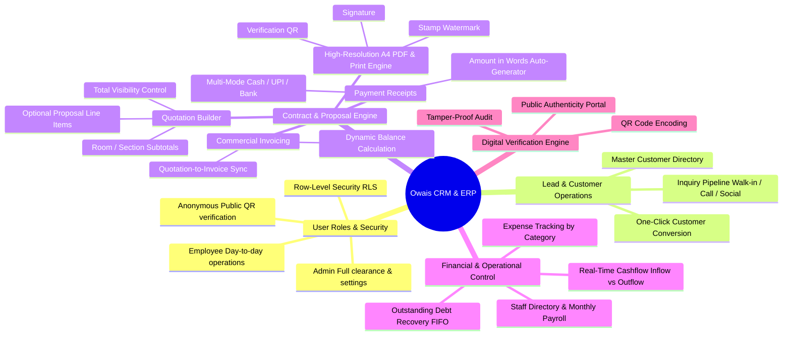
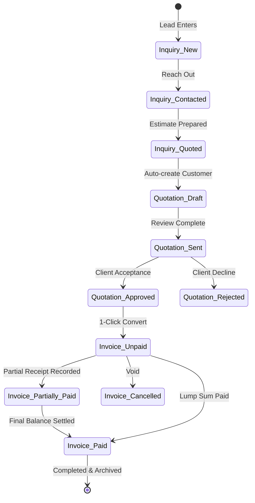
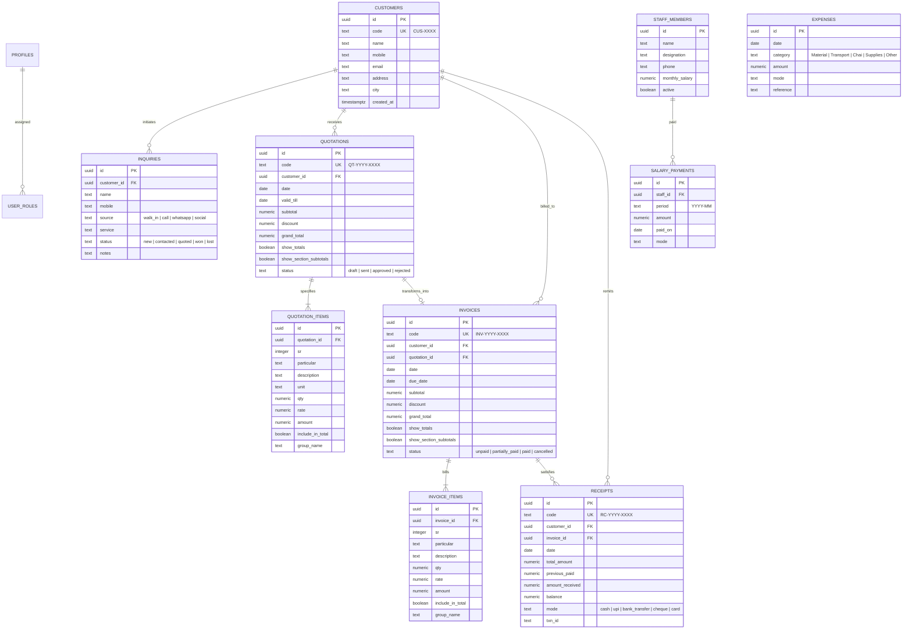

# Product Requirements Document (PRD)

## Project: Owais Interior Designer CRM & ERP Platform
**Document Version:** 2.0.0  
**Status:** Approved & Implemented  
**Owner:** Owais Interior Designer, Nashik  
**Target Platform:** Responsive Web Application (Desktop-first with Mobile Verification)

---

## 1. Executive Summary & Objectives

### 1.1 Purpose
Owais Interior Designer is an interior design firm operating in Nashik, Maharashtra. This CRM & ERP platform automates and unifies the end-to-end commercial lifecycle: from initial lead acquisition to detailed estimation with section grouping, formal client quotation, invoice billing, multi-mode receipt tracking, FIFO-based debt settlement, employee payroll, expense tracking, real-time cashflow analytics, and public QR-based document verification.

### 1.2 Core Business Objectives
* **Eliminate Estimating & Calculation Errors:** Provide dynamic calculators for line items, room/section-based subtotals, and optional proposals.
* **Streamline Revenue Tracking:** Track outstanding customer receivables and cashflow in real-time.
* **Establish Digital Trust:** Embed tamper-proof digital verification QR codes on all issued PDFs so clients and third parties can instantly verify document authenticity.
* **Simplify Team & Operational Expenses:** Manage staff monthly commitments and categorize daily business expenditures.

---

## 2. System Architecture Mindmap



---

## 3. User Personas & Role-Based Access Control (RBAC)

| Feature / Module | Administrator | Employee / Staff | Public Verifier (Client / Third Party) |
|---|:---:|:---:|:---:|
| **Authentication & Password Recovery** | Full Access | Full Access | No Auth Required |
| **Executive Dashboard & KPIs** | Full Access | Full Access | Restricted |
| **Inquiries & Lead Pipeline** | Full Access | Full Access | Restricted |
| **Customer Master Directory** | Full Access | Full Access | Restricted |
| **Quotations & Estimates** | Full Access | Full Access | Restricted |
| **Invoices & Billing** | Full Access | Full Access | Restricted |
| **Payment Receipts** | Full Access | Full Access | Restricted |
| **Outstanding Debt Recovery** | Full Access | Full Access | Restricted |
| **Staff Directory & Monthly Payroll** | Full Access | Full Access | Restricted |
| **Company Expenses & Cashflow** | Full Access | Full Access | Restricted |
| **Company Profile, Logo, Stamp & Signature** | Full Access | View Only / Blocked | Restricted |
| **Public QR Verification Page (`/verify/*`)** | Accessible | Accessible | Full Read-Only Access |

---

## 4. Functional Requirements

### FR-01: Authentication, Authorization & Security
* **Multi-Gateway Login:** Separate dedicated interfaces for Admin (`/admin-login`) and Employees (`/employee-login`).
* **Session Persistence:** Secure JWT session storage backed by Supabase Auth with automated token refreshing.
* **Password Reset Flow:** Password recovery mechanism utilizing Supabase Auth reset email triggers.
* **Row-Level Security (RLS):** Database tables strictly protect customer, quotation, and financial records, preventing unauthorized multi-tenant or anonymous data leakage while exposing curated public verification views.

### FR-02: Lead & Inquiry Pipeline
* **Source Attribution:** Log leads tagged with channels: *Walk-in*, *Phone Call*, *WhatsApp*, *Instagram*, *Website*, or *Referral*.
* **Service Classification:** Categorize inquiries by work scope: *Residential 2BHK/3BHK*, *Commercial Office*, *Modular Kitchen*, *Renovation*, or *False Ceiling*.
* **Status Lifecycle:** `New` &rarr; `Contacted` &rarr; `Quoted` &rarr; `Won` / `Lost`.
* **Lead Conversion:** Instant one-click action to create a permanent customer record in the Customer Directory from an inquiry.

### FR-03: Customer Directory & Master Data
* **Deterministic Identifier:** Auto-generated sequenced code: `CUS-0001`, `CUS-0002`.
* **Data Fields:** Full Name, Primary Mobile (10-digit validated), Alternate Phone, Email, Site/Billing Address, City, and Custom Notes.
* **Smart Search:** Real-time search across customer code, client name, mobile number, or city.
* **Cascade Deletion Protection:** Warning modal before deleting customers with linked quotations, invoices, or receipts.

### FR-04: Advanced Quotation & Proposal Engine
* **Identifier Format:** `QT-YYYY-XXXX` (e.g., `QT-2026-0001`).
* **Section Grouping & Subtotals:**
  * Group items into named zones/rooms (e.g. *"Living Room"*, *"Kitchen"*, *"False Ceiling"*).
  * Automatically compute and display subtotal sums per section.
  * Toggable display option (`show_section_subtotals`) to hide or display section subtotals on the final printed sheet.
* **Optional Proposal Items (`include_in_total`):**
  * Items can be designated as optional variations.
  * Marked with an `OPTION` badge on print sheets; excluded from the mathematical grand total.
* **Totals Visibility Toggle (`show_totals`):**
  * Allows generating itemized scope-of-work documentation without revealing financial grand totals.
* **Discounting & Tax Calculation:**
  * Percentage discount support with real-time numeric grand total recalculation.
* **A4 Print & PDF Rendering:**
  * High-resolution DOM-to-PDF rendering (`html2canvas-pro` + `jspdf`) formatted to 210mm x 297mm standard.
  * Company logo header, teal decorative rules, watermarked company seal/stamp, and authorized signature block.
  * Embedded digital verification QR code.
* **Invoice Conversion:** Single-click transfer of all quotation items, rates, and customer references directly into an active Invoice draft.

### FR-05: Tax & Commercial Invoicing
* **Identifier Format:** `INV-YYYY-XXXX` (e.g., `INV-2026-0001`).
* **Origin Tracing:** Explicit link back to parent `quotation_id` where applicable.
* **Real-time Status Synchronization:**
  * `Unpaid`: Invoice has zero recorded payments.
  * `Partially Paid`: Invoice has partial receipts logged (`0 < paid < total`).
  * `Paid`: Full invoice sum satisfied.
  * `Cancelled`: Voided invoice.
* **Payment Settlement Trigger:** Inline action to launch a pre-populated Payment Receipt targeting the specific invoice balance.

### FR-06: Payment Receipts
* **Identifier Format:** `RC-YYYY-XXXX` (e.g., `RC-2026-0001`).
* **Automated Ledger Pull:** Automatically loads previous payments and current balance upon selecting an invoice.
* **Payment Mode Tracking:** *Cash*, *UPI / GooglePay / PhonePe*, *Direct Bank Transfer / NEFT / RTGS*, *Cheque*, *Debit / Credit Card*.
* **Transaction Reference ID:** Dedicated tracking field for bank UTR, cheque numbers, or UPI transaction IDs.
* **Indian Number-to-Words Engine:** Converts numeric currency inputs into formal legal wording (e.g., *"Rupees One Lakh Twenty-Five Thousand Only"*).

### FR-07: Outstanding Receivables & Debt Aging
* **Customer Aggregations:** Displays total invoiced volume, total payments collected, and net receivable balance per client.
* **FIFO Settlement Pipeline:** Payments automatically apply towards the oldest open invoice first to prevent aging discrepancies.
* **Overdue Indicator:** Color-coded alert badges highlighting invoices that have crossed their `due_date`.

### FR-08: Staff Directory & Monthly Payroll
* **Staff Records:** Directory of employees and contract personnel with designation, contact phone number, monthly agreed salary, and active employment status.
* **Salary Payment Disbursements:** Record salary disbursements tagged by payout date, period month (`YYYY-MM`), payment channel, and notes.
* **Live Commitment Metrics:** Aggregated metrics calculating active personnel headcount and monthly salary liabilities.

### FR-09: Company Expenses & Cashflow Engine
* **Operational Expense Log:** Log operational business outflows categorized by *Material*, *Transport*, *Food/Chai*, *Office Supplies*, *Marketing*, and *Other*.
* **Real-Time Cashflow Analysis:**
  * **Lifetime Inflow:** Aggregate collections across all verified client receipts.
  * **Lifetime Outflow:** Operational expenses + staff salary payouts.
  * **Net Cash Reserves:** `Inflow - Outflow`.
  * **This Month Outflow:** Current month operational expenses + salaries.

### FR-10: Public Document Authenticity & QR Verification
* **Embedded QR Matrix:** Every quotation, invoice, and receipt features a high-contrast QR code pointing to `/verify/:type/:id`.
* **Public Verifier Portal:** Completely accessible without authentication; allows any smartphone camera or web client to scan and confirm:
  * Document Reference Code & Document Type
  * Issuing Organization: Owais Interior Designer
  * Issued Date & Status (Paid, Approved, etc.)
  * Customer Name, Code & Project City
  * Verified Transaction Amount
* **Tamper Prevention:** If a document's figures or code are manipulated on paper, the scanned QR portal displays the genuine database record or alerts "Document Not Found / Unverified".

### FR-11: Company Settings & Brand Assets
* **Central Brand Customization:** Manage company legal name, contact numbers, email, shop address, and bank payment instructions.
* **Digital Brand Assets:** Secure asset upload to Supabase Storage:
  * High-resolution Company Logo
  * Official Business Stamp (printed as transparent watermark)
  * Authorized Signatory Signature

---

## 5. Business Workflows & State Machines

### 5.1 Document Lifecycle & Payment Settlement



---

## 6. Data Architecture & Entity-Relationship Model



---

## 7. UI/UX Design System & Color Palette

### 7.1 Unified Status Color System
All entity statuses map through a centralized utility (`status.ts`) enforcing uniform color tokens:

```text
┌───────────────┬────────────────────────────┬─────────────────────────────┐
│ Semantic Role │ Tailwind Palette Tokens    │ Associated States           │
├───────────────┼────────────────────────────┼─────────────────────────────┤
│ Success       │ bg-emerald-50 text-emerald │ paid, approved, won, active │
│ Warning       │ bg-amber-50 text-amber     │ partial, sent, quoted       │
│ Information   │ bg-sky-50 text-sky         │ new, contacted              │
│ Danger        │ bg-rose-50 text-rose       │ unpaid, overdue, lost, void │
│ Neutral       │ bg-slate-100 text-slate    │ draft, fallback             │
└───────────────┴────────────────────────────┴─────────────────────────────┘
```

### 7.2 Micro-Interactions & Loading Strategy
* **Zero Blank States:** Table bodies render multi-column animated skeleton loaders instead of jarring layout shifts or plain "Loading..." text.
* **Transition Physics:** Universal smooth cubic-bezier transitions on buttons, links, and card elevation.
* **Document Fidelity:** Screen preview matches physical print output at 100% geometric ratio (210mm A4 width).

---

## 8. Non-Functional Requirements (NFR)

* **Performance & Latency:**
  * Initial dashboard render under 1.2 seconds.
  * Caching policy: `staleTime: 60s` on dashboard; `staleTime: 30s` on document directories to prevent redundant network fetches.
  * Limited database queries: Dashboard queries retrieve only recent 5 items (`.limit(5)`) instead of full table scans.
* **Data Security & Privacy:**
  * Row Level Security (RLS) active on all PostgreSQL tables.
  * Dedicated read-only RLS grant for anonymous verification role (`anon`).
* **Cross-Device Print Reproducibility:**
  * Explicit CSS `@media print` rules enforcing page breaks, A4 canvas sizing, zero margins, and elimination of navigation chrome during browser printing or PDF compilation.

---

## 9. Product Roadmap

### Phase 1 (Completed & Deployed ✅)
* Core CRM, Inquiries, Customer Master, Quotations with section grouping & optional items.
* Invoices, Receipts, Outstanding FIFO Debt Recovery.
* Staff Directory & Monthly Salary Logging.
* Operational Expenses & Real-time Lifetime Cashflow Analytics.
* QR Code generation & Public Document Verification Portal.
* Full UI/UX status color overhaul and query performance optimization.

### Phase 2 (Planned Next Steps 🚀)
* Automated WhatsApp notification engine for quotes and payment receipts.
* Multi-currency support for cross-border projects.
* Customer feedback and project progress milestone photos tracker.
